<p align="center"></p>

# Guppy for Mac

A clean, minimal YouTube downloader for macOS, written in Swift and SwiftUI. Paste a link, pick **Video** or **Audio**, and download. Guppy can also convert audio and video files on your Mac into common audio formats.

There's also [Guppy for Windows](https://github.com/duck28/guppy-for-windows), which does the same things.

## Features

- **Video:** MP4, MKV or WebM, from 360p up to 4K. MP4 prefers H.264/AAC so it plays everywhere (QuickTime included).
- **Audio:** MP3, M4A (AAC), Opus (128–320 kbps), or lossless FLAC and WAV.
- **Playlists:** a playlist link puts every video in the queue.
- **Convert files:** drop audio or video files on the window (or ⌘O) to convert them to the selected audio format.
- **Cover art and tags:** title, artist, chapters and the thumbnail are embedded (can be turned off in Settings).
- **Queue:** two downloads run at a time, with progress, speed and time left. You can cancel, retry, play or show any download in Finder.
- **Clipboard:** a YouTube link on the clipboard is picked up when you switch to Guppy (or press ⇧⌘V).

Guppy downloads with [yt-dlp](https://github.com/yt-dlp/yt-dlp) and converts with [FFmpeg](https://ffmpeg.org). It uses copies that are already installed (Homebrew, MacPorts, pip). If none are found, **Set Up** downloads them once (the standalone `yt-dlp_macos` and a static FFmpeg build from [ffmpeg.martin-riedl.de](https://ffmpeg.martin-riedl.de)) into `~/Library/Application Support/Guppy/bin`. **Settings › Update** gets the newest yt-dlp, which usually fixes downloads after YouTube changes something. With Homebrew, `brew install yt-dlp ffmpeg` works too.

Only download content you have the right to.

## Download and install

Requires macOS 14 or later, on Apple silicon or Intel (the app is universal).

1. Download `Guppy-<version>-mac.dmg` from the [latest release](https://github.com/duck28/guppy-for-mac/releases/latest).
2. Open the disk image and drag **Guppy** to **Applications**.
3. Open Guppy. The first time, macOS blocks it (see below).

### The app is not signed or notarized

Release builds are ad-hoc signed, not signed with an Apple Developer ID or notarized by Apple. When you open Guppy for the first time, Gatekeeper says that Apple could not verify it is free of malware and offers only **Done** or **Move to Trash**. To open it anyway:

1. Click **Done**.
2. Open **System Settings › Privacy & Security**, scroll down to the message about Guppy, and click **Open Anyway**. Confirm with your password.

Alternatively, remove the quarantine flag in Terminal: `xattr -dr com.apple.quarantine /Applications/Guppy.app`.

On macOS 14 you can also right-click the app and choose **Open**.

### Verify a download

Every release file is attested by the GitHub Actions run that built it ([build provenance](https://docs.github.com/actions/security-for-github-actions/using-artifact-attestations)). With the [GitHub CLI](https://cli.github.com):

```bash
gh attestation verify Guppy-1.0.0-mac.dmg --repo duck28/guppy-for-mac
```

## Build from source

Needs macOS 14 or later and the Xcode Command Line Tools (`xcode-select --install`); Xcode itself isn't required.

```bash
./build.sh
```

This builds a universal app (Apple silicon and Intel) at `build/Guppy.app` and a disk image at `build/Guppy.dmg`. The app is ad-hoc signed. To sign it with your own identity, pass `SIGN_IDENTITY="Developer ID Application: …" ./build.sh` (it would also need notarizing to open without a warning on other Macs).

- `./build.sh debug` builds a debug app without the disk image.
- `swift test` runs the unit tests. `GUPPY_INTEGRATION=1 swift test` also downloads a short video with the real yt-dlp and FFmpeg.
- The [build workflow](.github/workflows/build.yml) builds and tests every push to `main` and every pull request.

## Releasing

1. Set the new version in `Resources/Info.plist` (`CFBundleShortVersionString`, for example `1.0.1`, and increase `CFBundleVersion`).
2. Commit, then push a tag that matches the version with a `v` in front:
   ```bash
   git tag v1.0.1 && git push origin v1.0.1
   ```
3. The [release workflow](.github/workflows/release.yml) checks that the tag matches the version, runs the tests, builds `Guppy-<version>-mac.dmg` on a macOS runner, attests it, and creates a **draft** release. Review it on GitHub and publish it.

## Code

| Part | File |
| --- | --- |
| App, menus, quitting | `Sources/Guppy/GuppyApp.swift` |
| State, settings and queue | `Sources/Guppy/GuppyModel.swift` |
| Main window | `Sources/Guppy/ContentView.swift` |
| Settings window (⌘,) | `Sources/Guppy/SettingsView.swift` |
| Colors, logo, buttons | `Sources/Guppy/Theme.swift` (white and orange) |
| Finding and installing yt-dlp/FFmpeg | `Sources/Guppy/Tools.swift` |
| Video info and downloads (yt-dlp) | `Sources/Guppy/YTDLP.swift` |
| File conversion (FFmpeg) | `Sources/Guppy/Converter.swift` |
| Running the tools | `Sources/Guppy/ProcessRunner.swift` |

The logo is drawn in SwiftUI (`GuppyLogo`) from the same shapes as the Windows app's `logo.svg`. The app icon is `Resources/Branding/guppy-icon.png`, rendered from `guppy-icon.svg`.

## License

[MIT](LICENSE)
